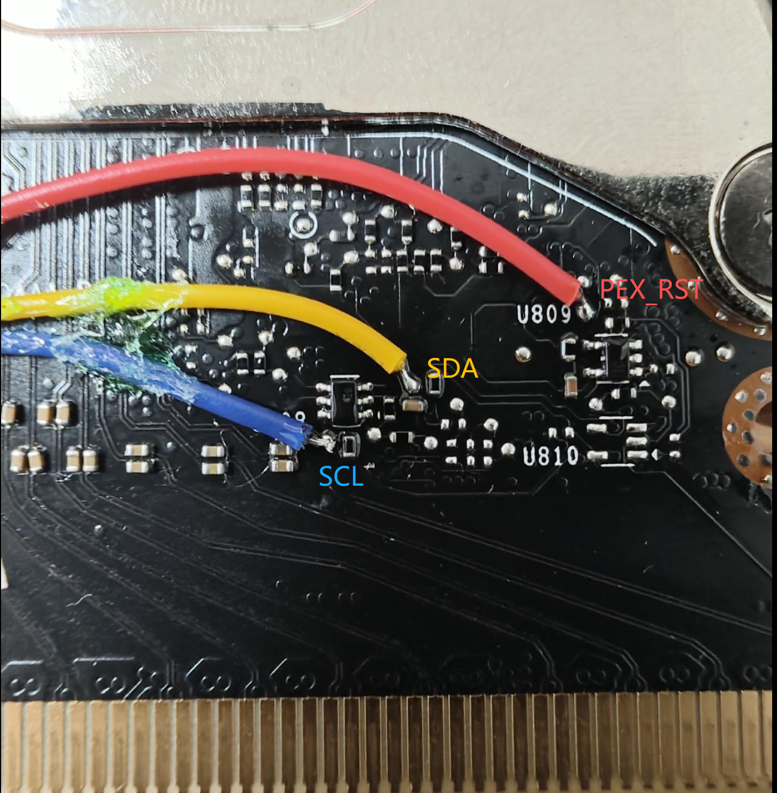
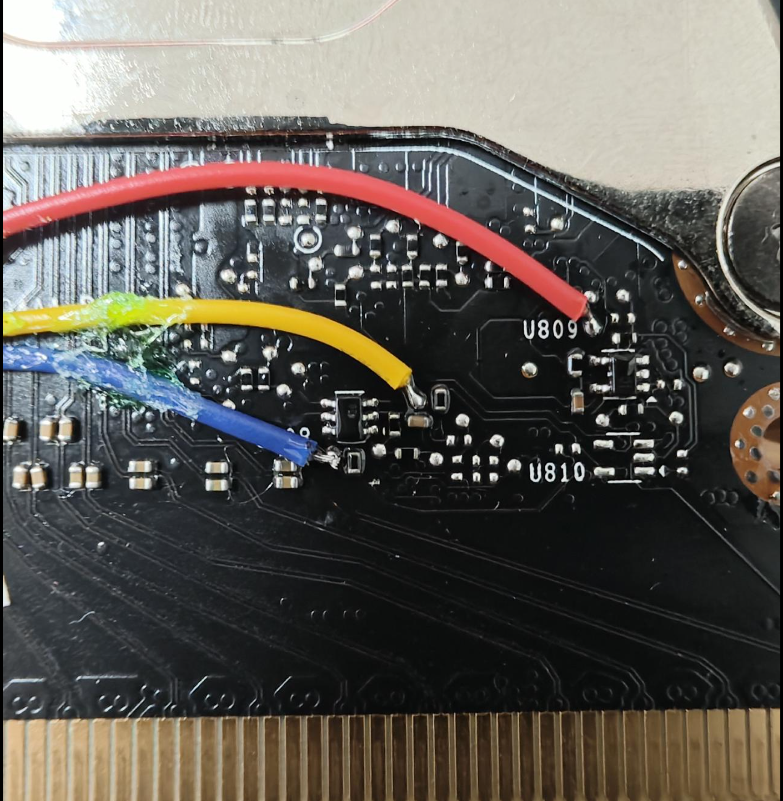
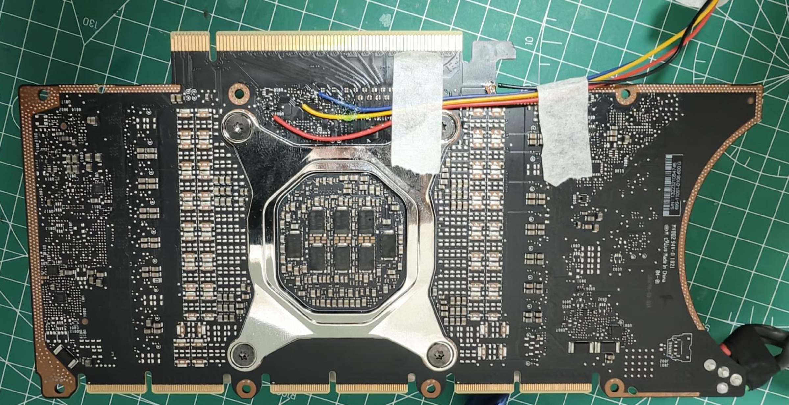

# esp32-ga100vfi 0.2.0

用 **ESP32-S3 电压毛刺**解锁 NVIDIA GA100 CMP 170HX（10de:20c2）并**永久烧写 FF 熔丝**的开源方案：
毛刺进入 Goldilocks 熔丝镜像状态 → 交叉验证烧写计划 → 追加 FF 记录 → 冷启重放，
把 8 GB 卡解锁为 80 GiB FB / 108 SM / NVLink / PCIe Gen4 潜力（几何显现与 Gen4 重训由驱动层配套完成，见「后续阶段」）。

本项目复制并改造自 [dalzyu/pico-ga100vfi](https://github.com/dalzyu/pico-ga100vfi)
（原 RP2350/Pico 实现）：毛刺原理与时序打法承袭上游；固件移植到 ESP32-S3（ESP-IDF / Arduino-ESP32），
主机端工具、HTTP 协议与熔丝烧写规程在本仓库重写。已在实卡上完整走通并永久化
（17 条 FF 记录冷启动后逐位回读一致，见「实测记录」）。

- 配套工具链（本仓库 `host/` + 同作者独立仓库 **ffcalc**）：快照、计划、仿真、验证
- 参考：[kate 的毛刺解锁长文](https://blog.kate.land/posts/using-voltage-glitching-to-unlock-the-a100/)、[cmpunlocker](https://github.com/amoghmunikote/cmpunlocker)（阶段二/三驱动）

> 提示：本项目推荐直接把仓库交给 AI 读取并协助部署（构建、烧录、接线核对、跑 campaign 均可），省心省力。

## 原理速览

GA100 在上电/`PEX_RST` 复位释放时对 512 行熔丝阵列做一次采样。用 PMBus 命令把 NVVDD
在采样窗口内打到恰好"扰动控制熔丝（row 0/1）但不破坏 CRC"的深度，得到 **Goldilocks** 状态：

| 状态 | 判据 | 含义 |
|---|---|---|
| **Goldilocks** | `DSOV=0` `CRC_STATUS=0x55` `SBFE=0` | 熔丝选项字可软件覆盖，可发起 FF 烧写 |
| under | `DSOV=1` `CRC=0x55` | 没踩到窗口，卡正常启动 |
| over / lost | `CRC=0x00` 或 BAR0 全 `FF` | 过度毛刺或启动挂死，等下一次 `r` |

Goldilocks 本身是**易失的**（任何复位/驱动加载即消失）。要永久解锁，必须在该窗口内向
熔丝阵列的空白行（本卡实测可用行 304–320）**追加 FF 记录**：`record = (data<<16)|(block<<6)|chain`。
FF 链按行号升序重放、**同一 chain.block 后写覆盖先写**，所以只追加、不擦改，天然安全；
清位规则（`new & ~old == 0`）+ defective 底线保证只解除 floorsweep、不点亮物理坏块。

### 熔丝宏寄存器与命令（本仓库实机验证）

| 寄存器 | BAR0 偏移 | 说明 |
|---|---|---|
| FUSECTRL | `0x00820000` | 写低 5 位发命令；FSM 状态在 `bits[20:16]`，IDLE=`0xE0040000` |
| FUSEADDR | `0x00820004` | 行号 0–511 |
| FUSEDATA | `0x00820008` | **读口**（CMD_READ 之后有效） |
| FUSEWDATA | `0x0082000C` | **写口**（PROGRAM 前写记录；写到 `0x820008` 会静默丢失） |
| FUSEDEBUG | `0x00820060` | 任何非 0 都禁止操作 |
| CRC_STATUS | `0x00820070` | `0x55` = 镜像有效 |
| EFP 状态 | `0x00820078` | ENABLE_FUSE_PROGRAM |
| DSOV 状态 | `0x00820084` | DISABLE_SW_OVERRIDE，Goldilocks 时 =0 |
| SBFE 状态/shadow | `0x00821108` | secured_burn_feature_enable；DSOV=0 时可写 0 解除烧写锁 |
| WDATA_WR_SECURE | `0x0082048C` | 写 0 后 FUSE/FUSEOPT PLM 自动全开（不要直接写 `0x8200F4/F8/FC`） |

| 命令 | 值 | 实测行为 |
|---|---:|---|
| CMD_READ | 1 | 读 FUSEADDR 行到 FUSEDATA，数十 µs 回 IDLE |
| CMD_PROGRAM | 2 | 经 `0xE00C0000`（WRITE_PROGRAM）回 IDLE；**空白行读回 `0x00000000`（不是 FF）** |
| SENSE_CTRL | 3 | 重采控制熔丝：EFP/SBFE 回融合值 1，**DSOV 保持 0**（本卡验证） |

FUSECTRL 读到 `0xBADFxxxx` = 命令失败、控制器锁死（不再应答任何读写）：**立即停止一切 BAR0 读**，整机断电再上电。

## 硬件与接线

| 功能 | GPIO |
|---|---:|
| I²C SDA（→ VRM 控制器 MP2888B SMBUS） | 6 |
| I²C SCL | 7 |
| PEX_RST，开漏输出（只下拉/释放，禁止推挽高） | 10 |
| UART0 TX / RX（控制台） | 43 / 44 |

引脚集中在 [main/board.h](main/board.h)，已内置 strapping/USB/flash/PSRAM 冲突的编译期检查。
选 6/7 是因为它们靠前且非特殊功能脚——许多 S3 开发板的 GPIO48 被板载 WS2812 灯占用，
0/3/45/46 是 strapping，19/20 是原生 USB，26–37 被 flash/PSRAM 占用。

ESP32-S3 不挑板子：没有自己的模组就随便买一块 ESP32-S3 开发板，按上表 GPIO 接线、刷入固件即可。
本仓库开发卡的毛刺板是早前 openUPS 项目遗留的模组，临时征用，并非必需规格。

SDA/SCL 接插件务必压实，总线"全死"最常见的原因就是接触不良。

**硬件特别提醒**（改接线、改 GPIO 或让 AI 改固件前先重读一遍）：

- `PEX_RST` 是 1.8 V 网络，而 ESP32-S3 的 pad 是 3.3 V：这根线**只能拉低或释放（高阻），
  绝不允许输出高电平**，任何情况下不得改成推挽驱动，否则 3.3 V 直接灌进 1.8 V 复位网络。
  固件里它终身固定为开漏（`GPIO_MODE_OUTPUT_OD`），改代码必须保持这一不变量。
- 某些特殊 IO（0/3/45/46 等 strapping 脚）在上电或下载模式下会被内部弱上拉自行拉高，
  不要接 `PEX_RST`，也不要接 SMBus——`board.h` 的编译期检查会拦住大部分错误选择。
- GND：建议显卡与毛刺板之间**直接接一根 GND 线**；实在不方便也可经主板/供电共地，
  只是回路绕远、毛刺期间地弹更大，尽量直连。

### 接线示例（开发卡实拍）

卡背面 SMBus 分接点与 `PEX_RST` 的焊接位置（黄 = SDA，蓝 = SCL，红 = PEX_RST，U809/U810 区域）：



同一机位无标注原图：



焊好后整卡背面全景（飞线成组引出）：



桌面整体接线环境（毛刺小板 ↔ 卡 ↔ 主板）：


## 固件与控制台

ESP-IDF / Arduino 构建见 [docs/BUILD.md](docs/BUILD.md)。启动后 SoftAP `GA100VFI`
（密码 `ga100glitch`，`http://192.168.4.1/`），组网后按启动日志的 LAN 地址使用。

**初次点亮后建议先给 ESP32-S3 配网**（网页 Wi-Fi 设置或串口 `@W`），让它接入实验室/家里的
现有 Wi-Fi，SoftAP 只作兜底。之后控制机（含卡所在主机）与板子在同一局域网，HTTP 接口、
判决代理和网页面板随时可调、可实时观察；配一次终身生效，后续从打毛刺到烧写基本都是自动操作。
下文示例中的 `192.168.4.1` 在配网后换成板子的 LAN 地址即可。

HTTP 接口（`host/ga100vfi_agent.py` 即按此协议实现 Linux 判决代理）：

| 端点 | 用途 |
|---|---|
| `POST /api/cmd`（body=命令行文本） | `u` 解锁 VRM 密码、`w` 回 PWM-VID、`r` PEX_RST 脉冲（=熔丝重感）、`g <参数>` 单发毛刺、`c` campaign |
| `GET /api/status` | 板卡/网络/阶段/看门狗面包屑 |
| `GET /api/campaign`（`op=start&…`/`op=stop`/查询） | 自适应爬山 campaign：`vd/td/vr/tr/batch/max/minv/maxv/step/pw/gap/pulses/wait/delays/mode` |
| `GET /api/verdict` | 最近判决（携带 `session+attempt`，拒绝旧轮次） |
| `GET /api/log?pos=` | 滚动日志 |
| `POST /api/ota` | 固件升级 |

## 主机接入：串口还是网络？

板子有两个等价控制面：**UART0 串行控制台**（115200 8N1）和 **Wi-Fi/HTTP**。
BAR0 判决永远在插着目标卡的 Linux 主机本地完成（`/sys/bus/pci/<bdf>/resource0` mmap 读取），
ESP32 从不搬运 BAR0 数据。区别只在"谁驱动循环、判决怎么闭环"：

| 方式 | 命令通路 | 判决通路 | 适用 |
|---|---|---|---|
| **A. 串口驱动**：`python -m ga100vfi attempt/campaign --port …` | 主机客户端经串口发 `u`/`g`/`w` | 同一台主机打完一发后**本地**读 BAR0 并分类，循环在主机脚本里 | 调试、首次打通 |
| **B. 板载 campaign + 网络代理**：campaign 在板内运行（`mode=1`），`host/ga100vfi_agent.py` 跑在卡所在主机 | 代理与板子之间**纯 HTTP**（轮询 `GET /api/status`，提交 `GET /api/verdict?session=&attempt=&r=`），走 SoftAP 或 LAN | 代理本地读 BAR0 做分类，只把**判决字符串**（goldilocks/hit/under/over/lost）经网络回传；串口此时只承担日志 | 长时间自适应爬山、无串口环境 |

两条路径的判决都绑定 `session+attempt`，过期轮次会被拒绝（HTTP 409）；代理对未确认结果幂等重试，不会为了重试重复执行寄存器分类。

```sh
# A. 串口驱动（attempt/campaign 的判决依赖与卡同机的 Linux sysfs）
python -m ga100vfi campaign --port /dev/ttyACM0 --bdf 0000:01:00.0 --adaptive

# B. 板载 campaign + HTTP 判决代理（先以 mode=1 启动流程，再跑代理）
curl "http://192.168.4.1/api/campaign?op=start&mode=1&vd=300&td=-1000&batch=4&step=25"
sudo python3 host/ga100vfi_agent.py http://192.168.4.1 --bdf 0000:01:00.0
```

## 端到端实操流程

### 1. 打毛刺命中 Goldilocks

```
u                                  # VRM 密码解锁（必须先于一切 w/g）
g <vd> <td> <vr> <tr> 0 1 0 1 <pw> <gap> 0 1 <wait>   # 单发试打
c op=start&vd=300&td=-1000&…&max=120&step=25          # 或自适应 campaign
```

命中判据：BAR0 config-space 探活后 `CRC=0x55`、`DSOV=0`（脚本模板见「实测记录」与 `host/`）。
经验（本卡）：单一长平型脉冲 `td=-1000 pw=15000`、`vd≈275–300`、`pulses=1`、命中前用
`wait≈8000` 给 GSP 启动留时间；hit 率约 1/10。

### 2. 快照与烧写计划（窗口内，全部只读 + CMD_READ）

计划与潜力分析用同作者仓库 **ffcalc**（`capture --read-ff-rows` → `gen` → `verify`，见其 README），
快照/核验/烧写执行也可完全走本仓库自含工具（标准库，无外部依赖）：

```sh
python3 -m ga100vfi.burn --bdf 0000:01:00.0 status      # 窗口判据（只读）
python3 -m ga100vfi.burn --bdf 0000:01:00.0 capture -o snapshot.json
python3 -m ga100vfi.burn crosscheck snapshot.json plan.burn.json   # 必须 0 问题
```

**烧前交叉验证清单**（`crosscheck` 自动做前四条，一次都不能省，全部可离线做）：

- 逐条重编码 `record == (new<<16)|(block<<6)|chain`，IFF 位（bit5）为 0；
- 清位规则 `new & ~old == 0`；`old` 必须等于"现有 FF 记录按行序回放"的 chain.block 值，
  且被新行覆盖的现有记录行号 < 新行号；
- 目标行在快照中必须为 `0`（空白行读 0）；同一计划内 chain.block 不得重复；
- 用 `ffcalc sim/gen` 重放"快照+计划"，得到的分析（FB GiB/SM/defective 底线）= 计划 `analysis`；
- 与参考烧写表做**语义**比对（chain.block 与字段一致即可，行号因卡而异）；
- 记下 `fingerprint`（defective 全字 + SBFE 的哈希）——它只认 die，烧前烧后必须一致
  （Glitch 窗口内采集的快照 SBFE=0，冷启后正常启动 SBFE=1，指纹会因这一行换 key，属预期）。
  **同批卡 defective 相同、出厂 SBFE 即为 1，指纹可与烧后完全相同**，多卡环境认卡用 UUID，
  烧写时逐行对快照是最后一道闸。

### 3. 烧写（OTP 不可逆，宁可中止不可硬来）

一条命令执行完整断言链（`--rows 315` 先试烧单行；逐条 PROGRAM + 回读核验；控制器一报错锁死（读 `0xBADFxxxx`）立即停止，rc=3）：

```sh
python3 -m ga100vfi.burn --bdf 0000:01:00.0 burn snapshot.json plan.burn.json --rows 315
python3 -m ga100vfi.burn --bdf 0000:01:00.0 burn snapshot.json plan.burn.json --yes
```

每条记录内部的断言序列（等价实现另见 ffcalc `burntool`，规程见其 docs/BURNING.md）：

```
0) 断言: FUSECTRL==0xE0040000, FUSEDEBUG==0, CRC==0x55, DSOV==0
1) wr FUSECTRL=3 (SENSE_CTRL)，轮询回 IDLE；断言 DSOV 仍为 0
2) arm:  wr SBFE(0x821108)=0 → wr WDATA_WR_SECURE(0x82048C)=0（PLM 自动全开）
3) 断言全齐: FUSECTRL=IDLE FUSEDEBUG=0 CRC=0x55 EFP=1 DSOV=0 SBFE=0
             WDATA_WR_SECURE=0 WDATA写口读回=0
4) wr FUSEADDR=row（回读核对）→ wr FUSEWDATA(0x82000C)=record → wr FUSECTRL=2
5) 轮询回 IDLE（实测 ~1 ms；期间可见 0xE00C0000；读到 `0xBADFxxxx` 或超时 → 停手，断电重启）
6) CMD_READ 该行，回读 == record；断言 CRC/DSOV 未变
```

纪律：**先烧 1 行测试**（建议 fbp 那条），验证回读与邻行未动，再烧其余；
每条记录之间重复第 3) 步断言；任何不满足 → 停止（未烧的行下次窗口继续）。

### 4. 冷启与复验

- 快捷通道：给板子发 `r`（PEX_RST 重感）。熔丝链立即重放——窗口作废，但可当场验证回放；
- 正式通道：**整机断电 ≥30 s** 再上电；
- 复验（全部应有）：卡正常枚举、`BOOT0=0x170000a1`、`CRC=0x55`、`DSOV=1`、`SBFE=1`；
  重新快照 → 17 行逐位一致、FF 区（222–486）其余行一字未动、defective 字不变、
  `gen` 重生成计划 = **0 条记录**；记录正常启动口径的新指纹（此后固定不变）。

### 5. 安全红线（全部来自实际事故或上游事故）

1. 控制器锁死（读到 `0xBADF…`）之后**不要再读 BAR0**——会挂死 PCIe 上游、整机复位；
2. FUSECTRL 非 IDLE 不许发下一条命令；
3. 记录编码/清位规则/空白行三查缺一不烧；写错 chain.block 就是永久改坏未知字段；
4. 永不直接写 PLM（`0x8200F4/F8/FC`）；用 WDATA_WR_SECURE=0 让 PLM 自动全开；
5. 驱动加载或 `PEX_RST` 都会终结窗口——计划、脚本、交叉验证在开窗前全部就绪；
6. `new & ~old == 0`：熔丝只能追加清位，点亮 defective 位 = 上电即坏。

## 实测记录（本仓库开发卡）

- 卡：CMP 170HX 8 GB（10de:20c2，die 指纹 `2d827969bc5001f4`），P1 板型 host `0000:01:00.0`；
- 命中：campaign `vd=300 td=-1000 vr=700 tr=3000 batch=4 pw=15000 gap=1500 pulses=1 wait=8000
  step=25 minv=250 maxv=450 delays=0,1600,3200,4800,6400,8000`，第 10 次尝试，自适应 `vd=275`；
- 烧写：17 条记录（行 304–320；fbio/fbpa/gpc/tpc/pes/fbp/rop_l2/nvlink/sys_pipe + PCIe
  2.39/2.47/2.49），全部一条命令一轮回 IDLE，未出现锁死；测试行 = fbp `0x420004c1`（row 315）；
- 冷启复验：17 行逐位一致；FF 区零意外改动；defective 16 字不变；fused 层 = 计划目标
  （`tpc_gpc3/6` status 层 0x1 为原厂固件运行时自掩蔽，参考机同款表现）；
  重生成计划 0 条，potential **80 GiB FB / 108 SM / NVLink / Gen4**；
  正常启动口径永久指纹 `3ab5093e8f9f78b5`；
- 未烧 MAGIC_D（chain 2 block 46/47）：该记录对带宽/Gen4 无收益，
  仅在刷 A100 VBIOS 时需要——保持保守，不烧。

## 后续阶段（熔丝之外）

熔丝解锁只解除 floorsweep；**80 GiB 显存显现**与 **Gen4 链路**属驱动层（阶段二/三），
用 [cmpunlocker](https://github.com/amoghunikote/cmpunlocker)（补丁驱动 615.71.09 +
`CMPUNLOCKER_CARD_PROFILE=mixed`，每次开机重写几何；Gen4 用其 RMPcieLinkSpeed/E1 重训路径），
要点见其仓库文档。

## 已知问题

- campaign 运行中执行 `op=stop` 若恰逢毛刺执行中，存在停止竞态 → TWDT 复位（卡会自己回来，
  板子重启；修复排期中）。规避：等当前 attempt 判决出来再 stop。

## 预编译固件

`firmware/` 提供本版交叉编译产物（Arduino-ESP32 3.3.11 / ESP32-S3，Flash 16 MB、OPI PSRAM）：

- `esp32-ga100vfi-0.2.0-merged.bin`：**全刷镜像**（bootloader + 分区表 + OTAboot + app，16 MiB），整片写到偏移 0 即可；
- `esp32-ga100vfi-0.2.0-app.bin`：应用固件，用于网页/`POST /api/ota` 升级（首次上板请先全刷）。

```sh
esptool.py --chip esp32s3 -p <串口> -b 921600 write_flash 0x0 esp32-ga100vfi-0.2.0-merged.bin
```

## 已知边界 / 声明

- `--port auto` 仅按已知 Espressif/Raspberry Pi USB VID 查找；外接 TTL 请显式指定串口。
- Linux BAR0 判决需要在插有目标卡的主机运行并正确指定 BDF。
- 复位时间轴由软件调度；`slip`/`reset_slip` 报告执行偏差，不保证确定性硬件时序（见 [docs/CALIBRATION.md](docs/CALIBRATION.md)）。
- `firmware/` 镜像为交叉编译产物；该版本未做实板刷写回归，红线与断言链照常适用。
- 熔丝烧写**不可逆**：请完整读完「安全红线」并逐条满足后再动手；本项目的实测结论
  （命令值、空白行=0、寄存器表）来自单卡单次样本，按"可复现假设"对待。

## 仓库与开发

| 路径 | 用途 |
|---|---|
| `main/` | 固件唯一维护源：命令、状态机、总线、网络及网页源文件 |
| `arduino/ga100vfi/` | Arduino sketch 和同步后的固件副本 |
| `host/` | Python 串口客户端、Linux 判决代理、集成烧写/核验工具（`ga100vfi.burn`）及离线测试 |
| `host/samples/` | 真实 bench 卡快照 + ffcalc 计划（回归测试样例，`host/tests/test_burn.py` 直接核对该计划） |
| `test/` | 本机 C 回归测试、外设替身与统一测试入口 |
| `tools/` | Arduino 源码同步、网页头文件生成 |
| `docs/` | 构建、协议、测量限制与测试结果 |
| `firmware/` | 本版预编译全刷/app 镜像（含 zip） |
| `partitions.csv` | N16R8 的 16 MB Flash 布局，含两个 3 MiB OTA 应用分区 |

```sh
python test/run_tests.py
python tools/gen_webui.py
python tools/sync_arduino.py
python -m pip install -e host
```

`main/` 是固件唯一维护源，`arduino/ga100vfi/` 中的 `.c/.h` 由 `sync_arduino.py` 生成。
本版主要变化（详见 [CHANGELOG.zh-CN.md](CHANGELOG.zh-CN.md)）：命令按完整行入队并拒绝非法输入；
单一硬件任务串行化总线操作；判决携带 `session+attempt`；遥测解析修复；
记录复位释放时间与执行偏差；I²C 改用 GPIO6/7；离线测试记录见 [docs/TEST_RESULTS.md](docs/TEST_RESULTS.md)。

## 许可

本仓库代码与文档采用 **Unlicense**（见 [LICENSE](LICENSE)）：公有领域，不保留版权。
引用的上游实现与外部研究（dalzyu/pico-ga100vfi、kate-land、amoghmunikote、hexkyz 等）版权归各自作者。
文中提及的商标（NVIDIA、GA100、CMP 等，以及乐鑫/Espressif 相关标识）均为相应权利人财产，提及仅为说明用途，不构成背书或隶属关系。
