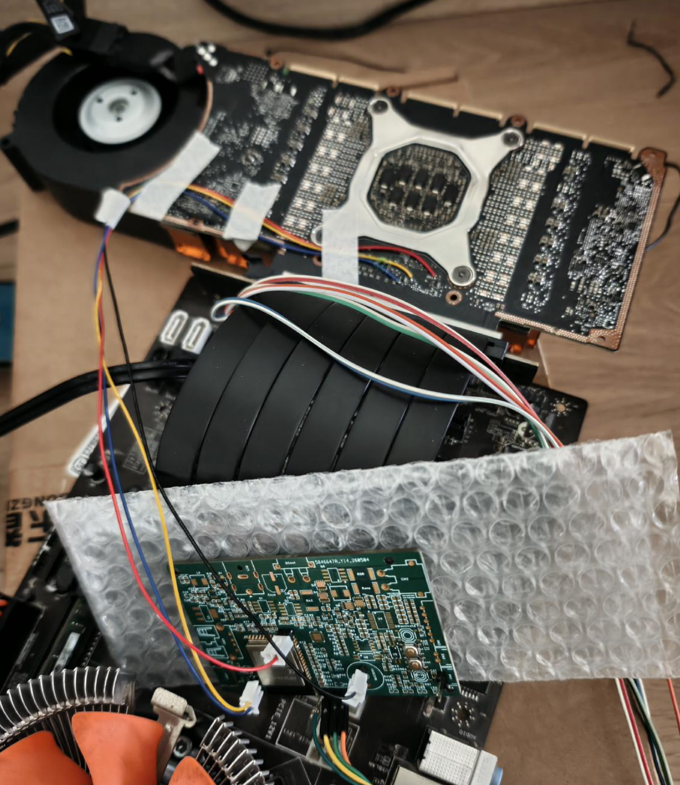

# esp32-ga100vfi 0.4.0

ESP32-S3 电压毛刺器，用于 NVIDIA GA100 CMP 170HX（`10de:20c2`）的 FF 熔丝解锁。流程固定为四步：毛刺进入 Goldilocks 状态（`DSOV=0` 且 `CRC_STATUS=0x55`）→ 生成 FF 烧写计划 → 交叉验证 → 追加 FF 记录 → 冷启重放。

0.4.0 的接线默认值为 **SDA=GPIO6 / SCL=GPIO7**（0.3.x 本台架接的是 47/48，升级后需按 §4 重接）。熔丝烧写进展见 [CHANGELOG.zh-CN.md](CHANGELOG.zh-CN.md)：第二张 `10de:20c2` 已按 §1.6 规程烧入 11 条记录（行 301–311）并冷启动复核通过。

本仓库开发卡实测结果：烧入 16 条记录（行 297–312），冷启后 `80 GiB FB / 124 SM / usable_fbp=10`，重扫剩余计划 0 条。

派生自 [dalzyu/pico-ga100vfi](https://github.com/dalzyu/pico-ga100vfi)（RP2350/Pico 实现）：毛刺原理与时序打法承袭上游；固件移植到 ESP32-S3（ESP-IDF / Arduino-ESP32）；主机端工具、HTTP 协议与熔丝烧写规程在本仓库重写。

| 依赖 | 用途 | 是否可替代 |
|---|---|---|
| **ffcalc**（同作者独立仓库） | FF 链分析、烧写计划生成、`verify`/`sim` 交叉验证 | 不可。计划与验证以它为准 |
| `host/ga100vfi`（本仓库） | 判决链、512 行采集、第二套独立对账、烧写执行 | 不可（本仓库工具与 ffcalc 互为独立实现） |
| [cmpunlocker](https://github.com/amoghmunikote/cmpunlocker) | 阶段二/三：驱动层几何显现与 Gen4 重训 | 熔丝之外，与本仓库无关 |

参考：[kate 的毛刺解锁长文](https://blog.kate.land/posts/using-voltage-glitching-to-unlock-the-a100/)。

---

## 0. 先读后动

熔丝烧写不可逆。执行任何开火或烧写动作前，先完整读完下表四份文件，并按其判据行动。本项目推荐把仓库整体交给 AI 读取后再由其执行操作；AI 同样适用本节。

| 顺序 | 文件 | 必须从中得到的结论 |
|---|---|---|
| 1 | 本文 §1（使用流程）、§2（判据与寄存器）、§3（安全红线） | 动作顺序、停止条件 |
| 2 | ffcalc 仓库 `docs/BURNING.md` | 寄存器与命令实机值、烧写七项授权断言、踩坑速查表 |
| 3 | [docs/UNLOCK_AND_POISON.md](docs/UNLOCK_AND_POISON.md) | VRM 锁态、`FUSECTRL` 四态、恢复顺序、电压窗口实测值 |
| 4 | [bench/README.md](bench/README.md) | 台架脚本用途与开火前闸门 |

AI 在动手前必须先复述以下五项；任一项说不出即不动手：

1. 目标卡的 `vendor:device`、PCIe BDF、UUID 与 fingerprint；
2. 当前 `FUSECTRL` 读数及其四态归类；
3. 计划记录数、行号范围、每条记录的 `chain/block/old/new`；
4. 分批烧写方案（第一条是哪一行，复核判据是什么）；
5. 停止条件（§3）与恢复顺序。

以下三类参数不许自行改动，也不许"顺手优化"：

- **波形参数**（`td vr tr pw gap pulses delay`）：只用 §1.3 的档案几何。改动只在 `under`/`over` 判据要求时进行，且必须留下台账证据。
- **寄存器地址与命令值**：§2 的表全部为实机确认值。
- **判据**：`FUSECTRL` 四态、poison 后禁止再读 BAR0、`new & ~old == 0`、目标行必须空白。

---

## 1. 使用流程

顺序固定，每一步都有判据；判据不满足就停在该步，不带病进入下一步。

本文档里的地址、口令、串口、BDF 一律是占位符，不给具体值：`<设备IP>` 是毛刺板的 LAN 地址（配网后由串口横幅或 `/api/status` 得到）、`<判决机IP>` 是插卡并跑 Linux 的主机地址、`<串口>` 是 TTL 适配器设备名、`<BDF>` 用 `lspci -D -d 10de:` 现取。台架脚本对这些值也不给默认——没填就退出，免得别人的台架地址变成你的操作目标。

以下命令都在判决机的仓库目录里执行，先把两个变量设好：

```bash
export BOARD=http://<设备IP>                            # 板子串口横幅或 /api/status 的 net.ip
export BDF=$(lspci -D -d 10de: | awk 'NR==1{print $1}') # 目标卡 BDF，多卡机自己确认是哪一个
```

### 1.1 准备

1. 按 §4 接线；刷入固件（§8 预编译固件，或按 [docs/BUILD.md](docs/BUILD.md) 自建）。
2. 板子配网：SoftAP `GA100VFI` / `ga100glitch`（固件内置默认，出厂即此，接入后用串口 `@W` 或 `http://192.168.4.1/` 的 Wi-Fi 设置页改成自己网络的 SSID 与口令）。配网易后统一用板子的 LAN 地址 `<设备IP>`。
3. 判决机部署（Windows 端一条命令，含落地自校验）：

   ```bat
   set BENCH_HOST=<判决机IP>
   set BENCH_USER=<判决机用户>
   set BENCH_PW=<判决机口令>
   python tools/deploy_bench.py
   ```

   三个变量都必须显式给出，缺任一即退出。部署会重装 `~/ga100vfi/{host,bench}`，并断言红线判据在包里、`bash -n` 全过、`FUSECTRL` 四态在机器上归类正确。台架脚本不放 `/tmp`：判决机每次重启清空 `/tmp`。

4. 连通性与版本检查（板子必须自报本次镜像；`crack.sh` 会拒绝版本不符的板子）：

   ```sh
   curl -s http://<设备IP>/api/status | python3 -c 'import json,sys; print(json.load(sys.stdin)["net"]["build"])'
   bash bench/poison_check.sh        # 只读一次 FUSECTRL
   ```

   刷板走 `BOARD=http://<设备IP> bash bench/ota.sh`（另给 `IMG=<镜像路径> EXPECT=<镜像 sha256 前缀>`），它回读 `/api/status` 的 `net.build` 自证版本。版本链条的三处断言见 [bench/README.md](bench/README.md)。

### 1.2 建立解锁状态

VRM 未解锁时每一发毛刺都在 `ensure_unlocked()` 门口返回，`PEX_RST` 不动，判决是对一张未被碰过的卡回 `under`。判据只看 `pwd`（`STATUS_CML(0x7E) & 0x08`）：

| 状态 | 现象 | 处置 |
|---|---|---|
| 无锁 | `pwd=1` | 直接开火，不再发 `u` |
| 故障锁 | `pwd=0`，`z` 能读到 | 先 `@w 25 03`（`CLEAR_FAULTS`）再 `u`，无需断电 |
| 总线无应答 | `z` 报 `ERR status read` | 查接线/地址/供电，与锁无关 |
| 真死 | 先清故障再交密码仍 `pwd=0` | 拔 12V + 3V3 ≥30 s |

`bench/crack.sh` 已内置该判定；手工核对用 `bash bench/console.sh z`。裸打之前不发 `w`：`w` 把 VRM 交回 PWM-VID 后 `VOUT_COMMAND` 被压制，窗口出不来。

### 1.3 打毛刺，命中 Goldilocks

```bash
# BOARD 必须已在上面设好：crack.sh 缺 BOARD 直接退出 2，不会拿任何默认地址开火
MAX=12 BATCH=2 VD=334 MINV=284 MAXV=384 STEP=25 DELAYS=54 \
  bash $HOME/ga100vfi/bench/crack.sh
```

默认参数即档案命中几何：`3 × 222 µs`、`gap 150 µs`、`delay=54`、锚点 `td=-40 vr=750 tr=-20`（首凹在 `PEX_RST` 释放前 94 µs，脉冲串在 0.9 ms 内结束，覆盖启动期熔丝采样窗）。本卡在该几何下 `vd=326`（PMBus 码 52）第 1 发命中。

`vd` 以 PMBus 码写入，LSB = 6.25 mV：`vd=334` 与 `vd=330` 是同一个码 53，写进 VRM 的电压相同。换档必须跨过一个 LSB（334 → 326 → 319）。

停止条件（`crack.sh` 已内置）：

- 出现 `lost` 立即停火。`lost` 表示该发之后 PCIe 链路未起；此时控制器处于半死态，补一发实测得到 poison。
- `FUSECTRL` 非 `IDLE`（含 `0xBADF…` 与叫不出名字的值）立即停火，不再读 BAR0。

命中判据（全部满足）：`FUSECTRL=0xE0040000`、`DSOV(0x00820084)=0`、`CRC_STATUS(0x00820070)=0x55`、`NV_FUSE_OPT_PRIV_LEVEL_MASK(0x008200FC)=0xffffffff`、FPF 行读回 `0xffffffff`。

### 1.4 窗口内取证（全部只读）

窗口是易失的：发 `r`（`PEX_RST`）、加载 `nvidia` 驱动、热重启都会关闭窗口。取证期间只允许 `CMD_READ`。

```bash
bash bench/window.sh                                        # classify / baseline / burn status / capture
cd $HOME/ga100vfi/host
python3 -m ga100vfi.burn --bdf "$BDF" status          # 窗口判据
python3 -m ga100vfi.burn --bdf "$BDF" capture -o rows.txt
python3 -m ga100vfi.burn --bdf "$BDF" capture -o rows2.txt
diff <(sort rows.txt) <(sort rows2.txt)                     # 必须 0 差异
```

512 行必须独立抓两遍并逐字节一致，不接受"只读一次就当真"。

### 1.5 生成计划，并用 ffcalc 交叉验证

四道闸门全部通过才允许进入 §1.6。ffcalc 与本仓库工具是两套独立实现，必须互相对账，不允许只信一套。

```bash
FFCALC=/path/to/ffcalc                       # ffcalc 仓库根目录
cd "$FFCALC"
python3 -m ffcalc.capture --bdf "$BDF" -o card-dump.json      # 61 个 option/defective/info 字
python3 -m ffcalc mergeff card-dump.json $HOME/ga100vfi/host/rows.txt   # 合并 512 行，必须报覆盖完整
python3 -m ffcalc gen card-dump.json -o plan.json
python3 -m ffcalc sim card-dump.json plan.json                       # 必须 SIMULATION OK、0 error
python3 -m ffcalc verify plan.json --dump card-dump.json             # 必须 OK: plan ... belongs to card（认 UUID/指纹）
cd $HOME/ga100vfi/host
python3 -m ga100vfi.burn --bdf "$BDF" crosscheck card-dump.json plan.json   # 必须 0 problems
```

`crosscheck` 独立复核的项（`host/ga100vfi/burn.py`）：

1. 记录重编码 `record == (new<<16)|(block<<6)|chain`，IFF 位（bit5）为 0；
2. 清位规则 `new & ~old == 0`（点亮 defective 位 = 上电即坏）；
3. `old` 等于 512 行按行序回放的 `chain.block` 值，且新行号大于被覆盖的现有记录行号；
4. 目标行在快照中为 `0`（空白行读 `0x00000000`，不是 `FF`），且同一计划内 `chain.block` 不重复；
5. 烧后回放等于计划 `new`；
6. 现场再逐行 `CMD_READ` 一次，目标行仍为空白。

FF 记录格式：`record[4:0]=chain`、`record[15:6]=block`、`record[31:16]=data`、bit5（IFF）必须为 0。FF 行范围 222–486。

认卡用 UUID；fingerprint 是 `*_defective` 全字 + SBFE 位的哈希，只用于确认"烧前烧后同一块 die"——同批卡 defective 相同、出厂 SBFE 可为 1，指纹可与他人卡相同。

### 1.6 烧写（分两批：先 1 条，再其余）

前提：`crosscheck` 为 `0 problems`；`burn` 子命令内部仍会重复全部离线断言、目标行现场回读、`window_ok()`、`sense()`、`arm()` 七项授权断言（`FUSECTRL=IDLE`、`FUSEDEBUG=0`、`CRC=0x55`、`EFP=1`、`DSOV=0`、`SBFE=0`、`WDATA_WR_SECURE=0`、`FUSEWDATA` 读回 0），任一项不满足即拒绝写入。`FUSEWDATA` 那条只在**第一条记录之前**成立：它是写口，上一条记录写进去的值就停在那儿，把它当"写口不干净"会让任何一次多于一条的烧写自己拒绝自己。

`EFP_STATUS(0x00820078)` 在刚进窗口时读 0，发过一次 `CMD_SENSE` 才为 1。`ga100vfi.burn` 在 `arm()` 前自动 `sense()`；ffcalc `burntool` 的 `in_write_window()` 硬要求 `EFP==1`，刚进窗口时会被它拒 burn——先发一次 `sense` 即可，不要判成"窗口坏了"。

**第一批：1 条。** 用计划中的 `fbp_disable`/`rop_l2_disable` 记录（本卡为行 307，`0x420004c1`，与 ffcalc 参考卡首次试烧同一条记录）：

```bash
python3 -m ga100vfi.burn --bdf "$BDF" burn card-dump.json plan.json --rows 307
python3 -m ga100vfi.burn --bdf "$BDF" capture -o rows_after_1.txt
```

复核判据（不满足即停手，不烧第二批）：`rows_after_1.txt` 相对 `rows.txt` **只有行 307 变化**，且该行等于 `0x420004c1`；`status` 的 `CRC` 仍 `0x55`、`DSOV` 仍 `0`、`FUSECTRL` 仍 `IDLE`、无 `0xBADF…`。

**第二批：其余全部。** 已烧过的那一行会由工具现场认出来并跳过（FF 是追加 + 后写覆盖，该行已经是计划的终态）。快照参数仍用烧前的 `card-dump.json`；0.4.0 起 `crosscheck` 接受"目标行已等于本条记录"这一形状（`resumed=`），所以续烧不需要换快照——换快照等于换个现场：

```bash
python3 -m ga100vfi.burn --bdf "$BDF" burn card-dump.json plan.json \
        --rows 297,298,299,300,301,302,303,304,305,306,308,309,310,311,312
python3 -m ga100vfi.burn --bdf "$BDF" capture -o rows_after_all.txt
python3 -m ga100vfi.burn diffrows card-dump.json rows_after_all.txt --plan plan.json
```

`burn` 子命令在写之前会现场回读计划涉及的每一行：读回**既不是空白也不是本条记录**的行直接拒绝（往这种行里 PROGRAM 是唯一救不回来的操作）。上面最后那条 `diffrows` 是必做步骤——判据是"只有计划内的行按记录改变"，不是"我烧的那几行变了"（IFF 区 487..511 我们这条路径读不准，已经排除在判据之外）。

2026-11-21 在第二张卡上的实烧（行 301 试烧 + 302..311 续烧）就是按本节顺序走的，差别只在当时每一步靠人执行。整条规程已收进 `bench/burn.sh`（含每步的人工确认），冷启动后的复核收进 `bench/postboot.sh`。

复核判据：相对 `rows.txt` **恰好 16 行变化、其余 496 行零改动**，16 行逐条等于计划 `record`；每条记录烧完后控制器回 IDLE（实测约 1 ms，期间可见 `0xE00C0000`）。中途出现 `0xBADF…` 或超时 → 立即停手，转 §3 恢复流程，未烧的行下次窗口继续。

单条记录的断言序列（`host/ga100vfi/burn.py`，ffcalc `burntool` 为等价实现）：

```
0) 断言 FUSECTRL=IDLE, FUSEDEBUG=0, CRC=0x55, DSOV=0
1) CMD_SENSE(3)，轮询回 IDLE，断言 DSOV 仍 0
2) arm：SBFE_SHADOW(0x00821108)=0 → WDATA_WR_SECURE(0x0082048C)=0（PLM 自动全开）
3) 七项授权断言全齐
4) FUSEADDR=row（回读核对）→ FUSEWDATA(0x0082000C)=record → FUSECTRL=2
5) 轮询回 IDLE；0xBADF… 或超时即停
6) CMD_READ 该行，回读 == record；断言 CRC/DSOV 未变
```

### 1.7 冷启验收

`PEX_RST` 让卡重新解析 FF 链，等价于完整冷启动，无需断电：重启判决机（POST 拉一次 `PERST#`）即触发 devinit 重解析。正式验收另做一次整机断电 ≥30 s。

冷启动后读 BAR0 之前先看配置空间的 `Command` 寄存器：没有驱动 claim 这张卡时 `Command=0x0000`（Memory Space Enable 未置），**BAR0 整片读回 `0xffffffff`**，形状与"卡掉了"不可区分。`python3 -m ga100vfi.burn --bdf "$BDF" wake` 就是这条处置（只写卡自己的 `Command` bit1）；`bench/postboot.sh` 第一步就是它。分岔点是配置空间答不答 `10de:20c2`：答＝decode 没开，不答才是掉卡。

```bash
python3 -m ga100vfi.burn --bdf "$BDF" wake
python3 -m ffcalc.capture --bdf "$BDF" -o card-post.json
python3 -m ffcalc mergeff card-post.json rows_after_all.txt
python3 -m ffcalc gen card-post.json -o plan-post.json     # 必须 0 条
python3 -m ffcalc report card-post.json                     # 潜力必须到顶：80 GiB / 124 SM
```

应有读数：`BOOT0=0x170000a1`、`CRC=0x55`、`DSOV=1`、`SBFE=1`；14 个 option 影子寄存器等于计划目标；`*_defective` 全部不变；FF 区除新 16 行外零改动。`CMD_SENSE` 不刷新 option 影子寄存器（只在 devinit 重算），所以生效验证必须走 `PEX_RST`。

已知正常现象：`tpc_gpc5/tpc_gpc7` 的 status 层为 1、fused 层为 0（原厂固件运行时自屏蔽，ffcalc `docs/BURNING.md` §5 有同款记录），不补烧。

### 1.8 熔丝之外

FF 只解除 floorsweep。`nvidia-smi` 的几何显现与 Gen4 链路属驱动层（阶段二/三），用 [cmpunlocker](https://github.com/amoghmunikote/cmpunlocker)（补丁驱动 + `CMPUNLOCKER_CARD_PROFILE=mixed`，Gen4 走其 RMPcieLinkSpeed/E1 重训），与本仓库无关。

---

## 2. 判据与寄存器

BAR0 偏移，全部实机确认：

| 寄存器 | 偏移 | 说明 |
|---|---|---|
| `FUSECTRL` | `0x00820000` | 低 5 位写命令；FSM 状态在 `bits[20:16]`，IDLE = `0xE0040000`，PROGRAM 中可见 `0xE00C0000`，`0xBADFxxxx` = 控制器锁死 |
| `FUSEADDR` | `0x00820004` | 行号 0–511，读写行前写它，读完恢复 |
| `FUSEDATA` | `0x00820008` | 只读数据口（写这里静默丢失） |
| `FUSEWDATA` | `0x0082000C` | 记录写入口 |
| `FUSEDEBUG` | `0x00820060` | 必须为 0 |
| `CRC_STATUS` | `0x00820070` | `0x55` = 镜像有效（H0/H1 均通过）；烧写后由控制器自动重算 |
| `EFP_STATUS` | `0x00820078` | 冷启后读 0，`CMD_SENSE` 后为 1 |
| `DSOV_STATUS` | `0x00820084` | Goldilocks 窗口内 = 0 |
| `NV_FUSE_OPT_PRIV_LEVEL_MASK` | `0x008200FC` | Goldilocks 下 `0xffffffff` |
| `SBFE_SHADOW` | `0x00821108` | `DSOV=0` 时可写；写 0 = 授权烧写；冷启恢复 1 |
| `WDATA_WR_SECURE` | `0x0082048C` | 写 0 → `PLM_FUSE` 自动全开（不得直写 `0x8200F4/F8/FC`） |

| 命令（写 `FUSECTRL` 低 5 位） | 值 | 实测行为 |
|---|---:|---|
| `CMD_READ` | 1 | 读 `FUSEADDR` 行到 `FUSEDATA`，数十 µs 回 IDLE；空白行读回 `0x00000000` |
| `CMD_PROGRAM` | 2 | 约 1 ms 回 IDLE |
| `CMD_SENSE` | 3 | 重解析 OTP→影子：EFP/SBFE 回融合值 1，`DSOV` 保持 0；不刷新 option 影子寄存器 |

`FUSECTRL` 四态判据（`host/ga100vfi/classify.py` `fusectrl_state()`，判决链、战役循环、台架脚本共用同一函数）：

| 读数 | 状态 | 处置 |
|---|---|---|
| `0xE0040000` | `idle` | 放行 |
| `0xFFFFFFFF` | `unreachable` | 判 `lost`，卡不在总线上；一发 `lost` 即停战（判决与停火命令同一次交出） |
| `0xBADFxxxx` | `poisoned` | 停手，禁止再读 BAR0 |
| 其他（实测 `0x00000000`） | `unknown` | 停手。该状态出现后同电压下一发实测为 poison |

`unreachable` 必须先于 `poisoned` 判定：`0xFFFFFFFF` 的状态位同为 31。

---

## 3. 安全红线

1. `FUSECTRL` 为 `0xBADFxxxx` 后不再读 BAR0：继续读会挂死 PCIe 上游、整机复位（事故 `logs/02`）。判决链已固化为代码：`classify()` 第一件事只读一次 `FUSECTRL`，命中即抛异常、停战役并退出，不存在"再读一次确认"。
2. `FUSECTRL` 非 IDLE 不发下一条命令。
3. 记录编码、清位规则、空白行三查缺一不烧。写错 `chain.block` 即永久改坏未知字段。
4. 永不直写 PLM（`0x8200F4/F8/FC`）；用 `WDATA_WR_SECURE=0` 让 PLM 自动全开。
5. 驱动加载或 `PEX_RST` 都会终结窗口：计划、脚本、交叉验证在开窗前全部就绪。
6. `new & ~old == 0`：熔丝只能追加清位。
7. 未解锁不开火（`pwd=0` 时 `PEX_RST` 不动，买到的是假 `under`）。
8. `writes_failed=1` 表示"根本没打出去"，不是"参数不对"。
9. 网格必须 `max ≥ ndelays × batch`，否则整个网格塌在一个电压点上。`bench/crack.sh` 开火前算并拒绝。
10. 恢复顺序：先重启判决机（POST 拉 `PERST#`），仍不可达再拔 12V + 3V3 ≥30 s。
11. 首次命中后先单烧 1 条并复核，再烧其余。已烧行不重写。

判据成因与实测证据：[docs/UNLOCK_AND_POISON.md](docs/UNLOCK_AND_POISON.md)。

---

## 4. 硬件与接线

| 功能 | GPIO |
|---|---:|
| I²C SDA（→ VRM 控制器 MP2888B SMBUS） | 6（0.4.0 默认值） |
| I²C SCL | 7（0.4.0 默认值） |
| `PEX_RST`，开漏输出 | 10 |
| UART0 TX / RX（控制台，115200 8N1） | 43 / 44（S3 默认，未重映射） |

选 6/7 的理由：避开 strapping（0/3/45/46）、原生 USB（19/20）、SPI flash（26–32）与 octal flash/PSRAM（33–37），并且不占用多数 S3 板的板载 WS2812（常在 48）。0.3.x 时期本台架接的是 **SDA=47 / SCL=48**，下方实拍即该接线；升到 0.4.0 后按上表重接两根 SMBus 线即可，`PEX_RST` 与串口不动。接线变更后必须核对 `/api/status` 的 `board.baud` 仍为 `1000000`：`bench/crack.sh` 已经把这条做成闸门（`EXPECT_BAUD`），因为波形配方是 1 MHz 的算术，速率降级会让每一发的沿宽与档案不可比。

引脚定义集中在 [main/board.h](main/board.h)，改引脚只改这三行。内含编译期检查：0/3/45/46（strapping）、19/20（原生 USB）、26–32（SPI flash）、33–37（octal flash/PSRAM，需 `GA_ALLOW_OCTAL_PINS` 显式放行）一律拒绝；三个角色不得共用一个引脚。若按上表接线后总线读不到 ACK，先查接触与上拉，再怀疑代码：固件不占用其他引脚。

ESP32-S3 不挑板子：任意 ESP32-S3 开发板按上表接线、刷入固件即可。本仓库开发卡的毛刺板为早前 openUPS 项目遗留模组，非必需规格。SDA/SCL 接插件必须压实：总线"全死"最常见的原因是接触不良。

两条硬件不变量：

- `PEX_RST` 是 1.8 V 网络，ESP32-S3 pad 是 3.3 V。该线只允许拉低或释放（高阻），任何情况下不得输出高电平、不得改成推挽驱动。固件中它终身固定为 `GPIO_MODE_OUTPUT_OD`，改代码必须保持该不变量。
- strapping 脚（0/3/45/46 等）在上电或下载模式下会被内部弱上拉拉高，不接 `PEX_RST`，也不接 SMBus。

GND：显卡与毛刺板之间直接接一根 GND 线。经主板/供电共地只作退路，回路绕远、毛刺期间地弹更大。

实拍（黄 = SDA，蓝 = SCL，红 = `PEX_RST`，U809/U810 区域）：




---

## 5. 固件、控制台与 HTTP

构建见 [docs/BUILD.md](docs/BUILD.md)。`/api/status` 的 `build` 字段与启动横幅都取 `main/board.h` 的 `GA_FW_VERSION`（当前 `0.4.0`）。证明"板上跑的是哪份镜像"用该字段 + `uptime`（重启后应为个位数秒）。

BAR0 判决永远在插着目标卡的 Linux 主机本地完成（mmap `/sys/bus/pci/<bdf>/resource0`），ESP32 不搬运 BAR0 数据。控制面有两个等价入口：

| 方式 | 命令通路 | 判决通路 | 适用 |
|---|---|---|---|
| A. 串口驱动 `python -m ga100vfi attempt/campaign --port …` | 主机经串口发 `u`/`g`/`w` | 同机打完一发后本地读 BAR0 分类 | 调试、首次打通 |
| B. 板载 campaign（`mode=1`）+ `host/ga100vfi_agent.py` | 代理与板子纯 HTTP：轮询 `GET /api/status`，提交 `GET /api/verdict?session=&attempt=&r=` | 代理本地读 BAR0 分类，只回传判决词 | 长时间爬山、无串口环境 |

两条路径的判决都绑定 `session+attempt`，过期轮次返回 HTTP 409；代理对未确认结果幂等重试，不为重试重复执行寄存器分类。

```sh
# A：--port 是 TTL 适配器设备名（Linux 常见 /dev/ttyACM0 或 /dev/ttyUSB0）
python -m ga100vfi campaign --port <串口> --bdf "$BDF" --adaptive
# B：<设备IP> 未配网时是 SoftAP 出厂地址 192.168.4.1，配网后换成板子的 LAN 地址
curl "http://<设备IP>/api/campaign?op=start&mode=1&vd=326&td=-40&vr=750&tr=-20&pw=222&gap=150&pulses=3&delays=54&batch=2&max=12&step=25"
sudo python3 host/ga100vfi_agent.py http://<设备IP> --bdf "$BDF"
```

| 端点 | 用途 |
|---|---|
| `POST /api/cmd`（body=命令行文本） | `u` 解锁 VRM、`w` 回 PWM-VID、`r` PEX_RST 脉冲、`g <参数>` 单发、`c` campaign |
| `GET /api/status` | 板卡/网络/阶段/看门狗面包屑、`build` |
| `GET /api/campaign`（`op=start|stop`/查询） | 自适应 campaign：`vd/td/vr/tr/batch/max/minv/maxv/step/pw/gap/pulses/wait/delays/mode` |
| `GET /api/verdict` | 提交判决（携带 `session+attempt`，拒绝旧轮次） |
| `GET /api/log?pos=` | 滚动日志 |
| `POST /api/ota` | 固件升级 |

---

## 6. 台架脚本

`bench/` 下，`python tools/deploy_bench.py` 装到判决机 `$HOME/ga100vfi/bench/`。用法与闸门见 [bench/README.md](bench/README.md)。

| 脚本 | 作用 | 写硬件 |
|---|---|---|
| `crack.sh` | 开火入口：网格闸门 + 三道预检 + campaign + 跨轮台账 | 是 |
| `run_crack.sh` | 薄壳：确认没有第二个进程碰卡，然后交给 `crack.sh`（不自带几何默认值） | 是（转交） |
| `window.sh` | 命中后取证（classify / baseline / burn status / capture） | 只读（含 `classify` 固有的一次 DSOV 写） |
| `burn.sh` | 烧写入口：`wake` → 窗口判据 → 快照 → 交叉验证 → 试烧一条 → 逐行核对 → 续烧其余 | 是（熔丝，不可逆） |
| `postboot.sh` | 冷启动后复核：`wake` + 控制器状态 + 与烧前快照逐行比 + 影子寄存器 | 只写 `Command` bit1 |
| `poison_check.sh` | 只读一次 `FUSECTRL` | 只读一个寄存器 |
| `card_probe.sh` | 卡在不在（含 `Command` 原始字与 memory decode 判读）、桥链路、残留驱动 | 只读 |
| `link_retrain.sh` | 对**桥**发 Retrain + rescan | 写桥，不碰卡 |
| `readtrip.sh` | 零发实验：重放判决链访问，判是否我们自己的读写打进 poison | 是（判决链原样） |
| `mkledger.sh` | 跨轮台账 `(delay,vd) → 判决`（含 `goldilocks`/`void`/`nojudge` 列） | 否 |
| `backfill_verdicts.sh` | 从运行目录回填 `verdicts.tsv`（真值台账） | 否 |
| `ota.sh` | 刷板并回读 `build` 自证版本 | 刷固件，不碰卡 |
| `console.sh` | UART0 控制台助手 | 取决于所发命令 |

---

## 7. 实测记录

### 本仓库开发卡（0.3.0，2026-11-20）

- 卡：CMP 170HX 8 GB，`10de:20c2`，BDF `0000:01:00.0`，烧前指纹 `58bf9ac855da7053`，烧后 `fc497d01b8255867`（SBFE 0→1）；
- 命中：档案几何，第 1 发 `vd=326`（PMBus 码 52）、`delay=54`；
- 烧写：16 条记录，行 297–312（`fbio`/`fbpa`/`gpc`/`tpc0..7`/`pes`/`fbp`/`rop_l2`/`nvlink`/`sys_pipe` + chain2 的 3 条 PCIe 位）；先烧行 307，复核后烧其余 15 条；全程 `CRC=0x55`、无 poison；
- 冷启验收：14/14 option 影子寄存器等于计划目标，`gpc_disable=0x0`、`fbp_disable=0x840`、`rop_l2_disable=0xc03000`、`pes_disable=0x0`、`fbio/fbpa=0xc03000`，`fbp_defective=0x840` 原样保留；
- 重扫：`ffcalc gen` 剩余计划 **0 条**，潜力 `80 GiB / 124 SM / usable_fbp=10`，`FF rows: 91 used, 174 free`；
- 链路：`LnkSta` 仍 `2.5GT/s ×2`。该卡出厂为 Gen1 x4，x16 需 PCIe 电容改造，与 FF 无关；
- 现场证据：`burnplan/`（`plan.json`、`card-dump.json`、`crosscheck_report.md`、`after_row307.json`、`after_all16.json`、`snapshot_post.json`、`plan-post-empty.json`、ffcalc `verify`/`sim` 输出）。

### 第二张卡（0.3.2，2026-11-21）

- 卡：CMP 170HX，`10de:20c2`，BDF `0000:01:00.0`，烧前 FF 区 217 行非零；
- 命中：`delay=64`、`vd=372`，`goldilocks`（`DSOV=0` 且 `CRC=0x55`）—— 本台账 112 发里的第一次；
- 烧写：11 条记录，行 301–311。先试烧行 301 并独立重读（只有该行变化），再续烧 302..311；每条回读等于记录值，收尾 `CRC=0x55`、`FUSEDEBUG=0`、`DSOV=0`、控制器 IDLE；
- 冷启复核：`CRC=0x55`、`FUSEDEBUG=0`、`SBFE_SHADOW=1`、窗口按预期关闭；影子与计划覆盖面一致（`gpc_disable 0x13→0`、`nvlink 0x7→0`、`pes 0x3f07→0`、`sys_pipe 0xfe→0`、TPC 若干），计划未涉及的 31 个字段逐位不变；重扫 `gen` 剩余 **0 条**；FF 区非零行 217→228，剩余空白 175 行；
- 未闭合观察：`analysis.sm_count=124` 按"目标＝缺陷位"口径计，影子口径实算 120（GPC3/GPC5 各仍关 1 个 TPC），差 4 尚未对上；
- 现场证据：判决机 `$HOME/ga100vfi/logs/20261121-072343-window/`、`…-073042-burn-row301/`、`…-073205-burn-rest/`、`…-073721-postboot2/`。

### 参考样例卡（`host/samples/`）

`bench-card-85b20be7.json` + `.burn.json`：17 条记录，行 304–320，指纹 `3ab5093e8f9f78b5`，潜力 `80 GiB / 108 SM`。`host/tests/test_burn.py` 直接核对该计划。`tpc_gpc3/6` 的 status 层 0x1 / fused 层 0x0 为原厂固件运行时自屏蔽，属正常。

### 未烧项

`MAGIC_D`（chain2 block 45/46/47）不参与本卡计划的字段收益时不烧；本卡仅 `pcie_magic_gen4_dis`（= `magic_d` 的 bit25）随 Gen4 位一起被清，`magic_d` 因此从 `0x16680000` 变 `0x14680000`，属同一改动的必然结果。

---

## 8. 仓库、构建与固件

| 路径 | 用途 |
|---|---|
| `main/` | 固件唯一维护源：命令、状态机、总线、网络、网页源文件 |
| `arduino/ga100vfi/` | Arduino sketch 与同步后的固件副本（`python tools/sync_arduino.py` 生成） |
| `host/` | 串口客户端、Linux 判决代理、`ga100vfi.burn` 集成烧写/核验工具及离线测试 |
| `host/samples/` | 参考卡快照 + ffcalc 计划（回归样例） |
| `test/` | 本机 C 回归测试、外设替身、统一测试入口 |
| `bench/` | 判决机台架脚本（见 bench/README.md） |
| `tools/` | `sync_arduino.py`、`gen_webui.py`、`deploy_bench.py`、`gen_manifest.py`、`package_firmware.py`、`pack_src_tests.py` |
| `docs/` | 构建、架构与时序限制、测试结果、解锁与 poison |
| `burnplan/` | 本轮解锁的权威证据 |
| `firmware/` | 本版预编译镜像 |
| `partitions.csv` | N16R8 的 16 MB Flash 布局，两个 3 MiB OTA 应用分区 |

```sh
python test/run_tests.py            # 离线 C + Python 回归（无编译器时用 tools/pack_src_tests.py --run）
python tools/gen_webui.py           # 改网页后
python tools/sync_arduino.py        # 改 main/*.c|h 后必须执行
python -m pip install -e host
python tools/deploy_bench.py        # 部署判决机（含红线与版本一致性断言）
python tools/pack_src_tests.py --run   # 判决机上跑 C 回归（退出码即门禁）
python tools/gen_manifest.py        # 重新生成 MANIFEST.sha256
```

发布门禁（依次通过才算一版）：

```sh
python tools/sync_arduino.py
arduino-cli compile --fqbn "esp32:esp32:esp32s3:FlashSize=16M,PSRAM=opi" --build-path build-arduino arduino/ga100vfi
python tools/package_firmware.py --prune     # 按 board.h 版本打包，写 firmware/RELEASE.json
python tools/package_firmware.py --check     # 发布的镜像必须来自当前固件源码
python tools/pack_src_tests.py --run         # OFFLINE REGRESSIONS PASSED
python tools/deploy_bench.py                 # 台架与红线断言
python tools/gen_manifest.py                 # 重新生成 MANIFEST.sha256
python tools/gen_manifest.py --check         # 清单必须覆盖当前跟踪文件
```

`firmware/RELEASE.json` 记录版本、镜像内构建串（`X.Y.Z (Mon DD YYYY HH:MM:SS)`，由 `main/board.h` 的 `GA_BUILD_STAMP` 印入）、每个镜像的 sha256、固件源码摘要与构建时的 git 状态。构建串说明"是哪一次编译"，源码摘要说明"输入是哪些文件"；`--check` 用后者拒绝"源码改了但镜像还是旧的"（CRLF 差异不计入摘要，跨平台检出结果一致）。`git` 一栏是打包那一刻的工作树状态：`commit` 是当时的 `HEAD`，`dirty: true` 表示工作树相对该提交有改动，因此镜像不能等同于那次提交——要一份可复现的发布镜像，先提交再打包。

`MANIFEST.sha256` 记录 git 规范化内容的哈希（不含自身），Windows 与 Linux 检出结果一致；新增/改名/删除文件后 `--check` 会点名具体文件。

预编译固件（Arduino-ESP32 3.3.11 / ESP32-S3，Flash 16 MB、OPI PSRAM，构建串 `0.4.0 (Nov 21 2026 16:03:02)`）：

| 文件 | 大小 | sha256 |
|---|---:|---|
| `esp32-ga100vfi-0.4.0-app.bin` | 893,920 B | `40272836e797c3ae3ba070527f662c24c69cdb0374e61b2cb4942f0b09f59831` |
| `esp32-ga100vfi-0.4.0-merged.bin` | 16,777,216 B | `4fd4f012f8db0a5ff304179e12ac119944c747aa6c210d1c2a301126f903992d` |

（`.bin.zip` 内各含一个同名 `.bin`；zip 自身哈希由 `MANIFEST.sha256` 覆盖。打包时 `git` 一栏为 `99c0df3`、`dirty: false`。）

- app 镜像用于网页 / `POST /api/ota`；
- merged 镜像（bootloader + 分区表 + OTAboot + app）用于首次上板整片刷写到偏移 0。

```sh
esptool.py --chip esp32s3 -p <串口> -b 921600 write_flash 0x0 esp32-ga100vfi-0.4.0-merged.bin
```

刷 0.4.0 之前先移线：I²C 默认引脚已从 47/48 改为 6/7（§4）。刷完必须核对 `/api/status` 的 `board.baud` 为 `1000000`。0.3.1 与 0.3.2 的镜像记录见 [docs/TEST_RESULTS.md](docs/TEST_RESULTS.md)。

重新出镜像：`python tools/package_firmware.py --prune`（版本取 `main/board.h`，产物名随之变化），然后 `python tools/gen_manifest.py`。

---

## 9. 边界与已知问题

- `--port auto` 仅按已知 Espressif/Raspberry Pi USB VID 查找；外接 TTL 需显式指定串口。
- Linux BAR0 判决需在插有目标卡的主机运行并正确指定 BDF。
- 复位时间轴由软件调度；`slip`/`reset_slip` 报告执行偏差，不承诺确定性硬件时序（[docs/CALIBRATION.md](docs/CALIBRATION.md)）。
- campaign 运行中执行 `op=stop` 若恰逢毛刺执行中，存在停止竞态 → TWDT 复位（卡与板子自行恢复）。规避：等当前 attempt 判决出来再 stop。
- 实测结论（命令值、空白行=0、寄存器表、电压窗口）来自单卡样本，按"可复现假设"对待。
- `/api/status` 的 `board.vout_uv` 取自 `STATUS_VOUT(0x0b)` 的 bit4（bit0..3 按 0.125 mV/位线性解码）。该位位置没有厂商文档佐证，本仓库两次实测均观察到 bit4 恒为 1；两种解码相差 8 倍，而 1000 V 与 125 V 之间明显可读错的那个是前者，因此取 `bit4<<4`。**未证实**：读数只用于"VRM 是否应答"，不许当作 12V 轨电压的测量值引用。
- dip 内的 ADC 遥测按固定 500 µs 步长采样（`main/glitch_plan.c`），不是逐点记录：`td`/`tr` 小于该步长时，`adc_min` 与 `vout_uv` 只能证明"这段窗口里采到过什么"，不能证明 dip 底部的形状。

---

## 许可

本仓库代码与文档采用 **Unlicense**（见 [LICENSE](LICENSE)）：公有领域，不保留版权。引用的上游实现与外部研究（dalzyu/pico-ga100vfi、kate-land、amoghmunikote、hexkyz 等）版权归各自作者。文中提及的商标（NVIDIA、GA100、CMP 等，以及乐鑫/Espressif 相关标识）均为相应权利人财产，提及仅为说明用途，不构成背书或隶属关系。
